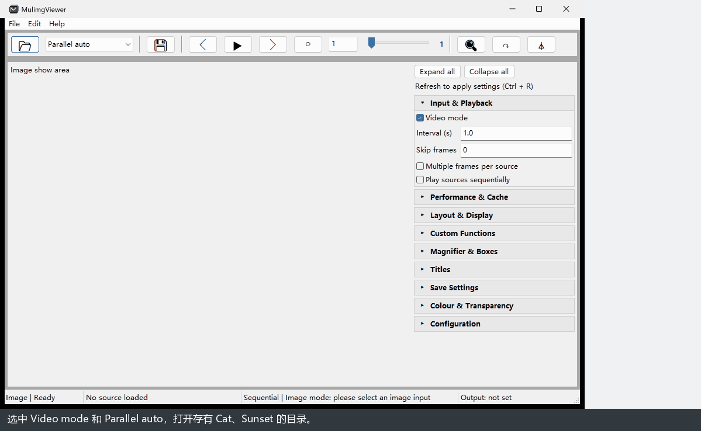
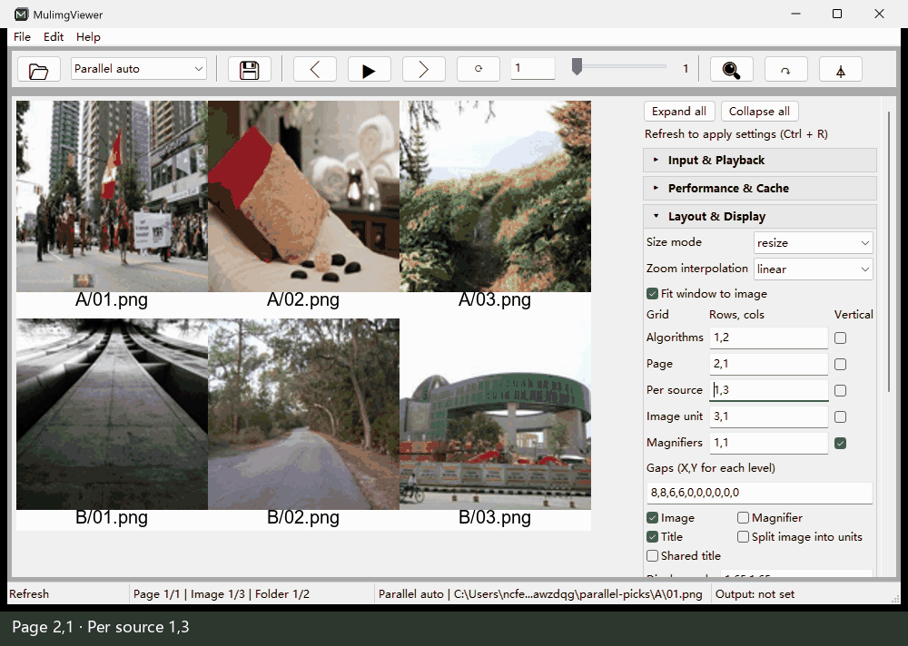
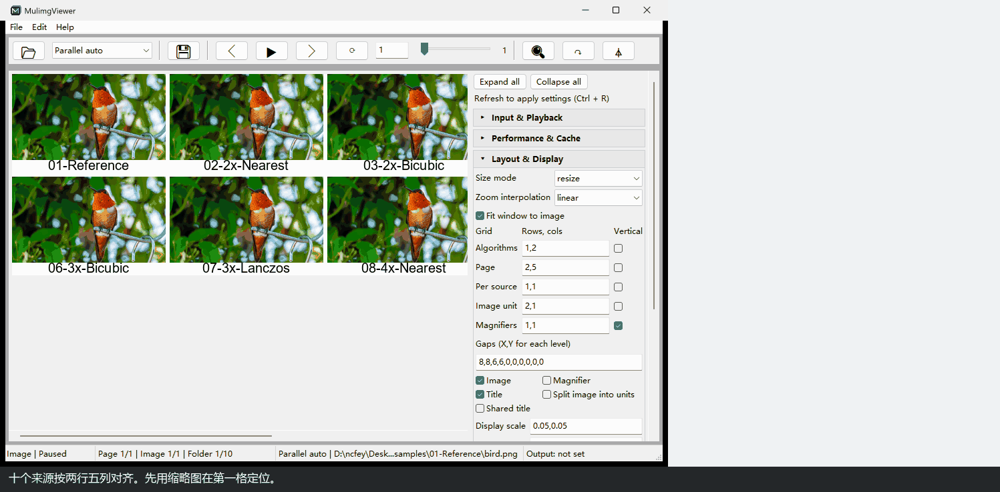

<p align="center"></p>

# MulimgViewer · {{version}}

<!-- manual-links -->

[English](https://mulimgviewer.readthedocs.io/zh-cn/latest/i18n/en/) · [简体中文](https://mulimgviewer.readthedocs.io/zh-cn/latest/) · [हिन्दी](https://mulimgviewer.readthedocs.io/zh-cn/latest/i18n/hi/) · [Español](https://mulimgviewer.readthedocs.io/zh-cn/latest/i18n/es/) · [العربية](https://mulimgviewer.readthedocs.io/zh-cn/latest/i18n/ar/) · [Français](https://mulimgviewer.readthedocs.io/zh-cn/latest/i18n/fr/) · [বাংলা](https://mulimgviewer.readthedocs.io/zh-cn/latest/i18n/bn/) · [Português](https://mulimgviewer.readthedocs.io/zh-cn/latest/i18n/pt/) · [Bahasa Indonesia](https://mulimgviewer.readthedocs.io/zh-cn/latest/i18n/id/) · [اردو](https://mulimgviewer.readthedocs.io/zh-cn/latest/i18n/ur/) · [Русский](https://mulimgviewer.readthedocs.io/zh-cn/latest/i18n/ru/) · [Deutsch](https://mulimgviewer.readthedocs.io/zh-cn/latest/i18n/de/) · [日本語](https://mulimgviewer.readthedocs.io/zh-cn/latest/i18n/ja/) · [Naijá](https://mulimgviewer.readthedocs.io/zh-cn/latest/i18n/pcm/) · [مصرى](https://mulimgviewer.readthedocs.io/zh-cn/latest/i18n/arz/)

<!-- /manual-links -->

在 Windows、macOS 和 Linux 上并排浏览图像、视频和算法结果。翻一页，各来源同步前进；画一个框，各来源显示同一处细节；点选一个位置，即可成组保存对应样本。


## 用两段视频开始

把 [Cat.mp4](docs/media/example-videos/Cat.mp4) 和 [Sunset.mp4](docs/media/example-videos/Sunset.mp4) 放进同一文件夹。勾选 **Video mode**，选择 **Parallel auto** 并打开该文件夹。将 **Page** 设为 `1,2`，**Per source** 设为 `1,1`。按 **Ctrl+R** 应用设置，点击 **▶** 播放，按 **Esc** 暂停。下面沿用录屏里的英文控件名；如需中文界面，可在 **Language** 菜单中切换。

## 七个对比案例

### 1. 并排查看每路视频的连续三帧

勾选 **Multiple frames per source**，将 **Per source** 设为 `1,3` 后刷新。横向看同一视频的运动变化，也可以对照不同视频中同一位置的帧。



### 2. 在多张图上同步放大同一处细节

勾选 **Magnifier**，在一张图上框选感兴趣的区域，即可对比各来源的对应局部。再画一个框，就能同时检查第二处细节。


### 3. 从画面追溯到源文件

打开索引表，定位主窗口中选中的图像，查看其来源路径和图像或视频帧路径。双击表中某一行，主窗口会跳到对应页面。


### 4. 点击一个位置，成组挑出对应样本

用并行模式打开[两组示例图像](docs/media/example-images)。勾选 **Multiple frames per source**，将 **Per source** 设为 `1,3` 后刷新。点击第二张，在保存设置中选择 **Selected images** 并指定输出目录，然后按 **Ctrl+S**。两个来源中该位置的图像会分别保存。



### 5. 对照原图与自定义算法结果

在 **Custom Functions** 选择 **Gaussian Blur**，勾选 **Selected** 和 **Show original panel**，将 **Algorithms** 设为 `1,2` 后刷新。要导出这张对比图，选择 **Stitch** 并指定输出目录，再按 **Ctrl+S**。


### 6. 用五层网格把多维数据排在一页上

每层网格都可独立设置行列数。录屏中 **Algorithms** 为 `2,1`、**Page** 为 `1,2`、**Per source** 为 `1,2`、**Image unit** 为 `3,1`、**Magnifiers** 为 `1,2`。两个算法面板各展示两个来源，每个来源取连续两帧，每帧再对照两处局部。一页就能看到 8 幅全图和 16 个局部，翻页后仍可按相同位置做对比。


### 7. 在十张超 4K 图像上做 1:1 像素对比

画一个框，隐藏 **Image**，保留 **Magnifier** 和 **Title**，将显示比例和放大比例都设为 `1,1`。示例只显示十张 4608 × 2592 图像中同一块 160 × 160 像素区域。打开[无损 PNG 对比图](docs/media/sr-detail-native.png)，按 100% 查看插值算法在边缘处留下的差异。



## 交流与引用

QQ 交流群 **945669929**。报告问题或提出功能建议，请前往 [GitHub Issues](https://github.com/nachifur/MulimgViewer/issues)。


```bib
@software{MulimgViewer,
  author  = {Liu, Jiawei},
  license = {GPL-3},
  title   = {{MulimgViewer: A multi-image viewer for image comparison and image stitching}},
  url     = {https://github.com/nachifur/MulimgViewer}
}
```

[引用信息](CITATION.cff) · [许可证](LICENSE) · [更新记录](CHANGELOG.md) · [下载软件](https://github.com/nachifur/MulimgViewer/releases)
