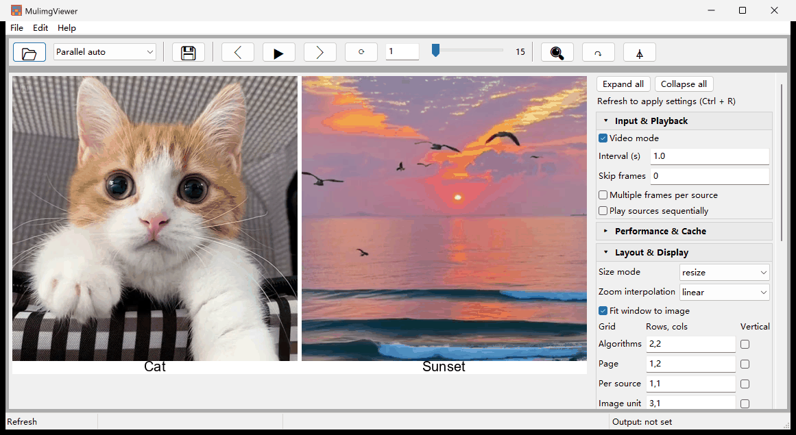
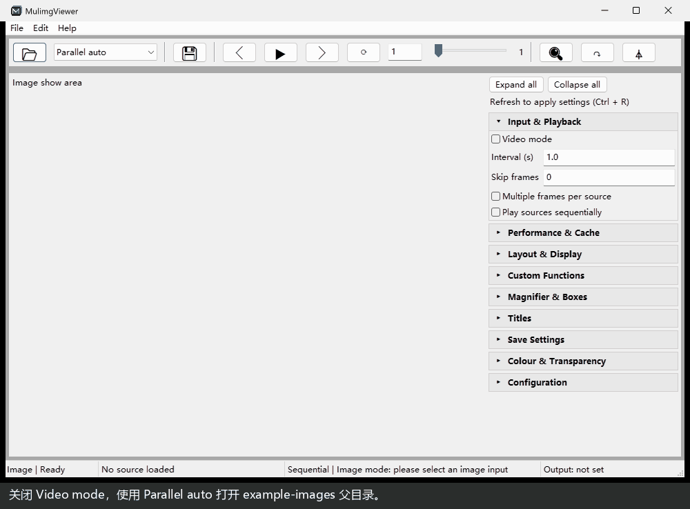
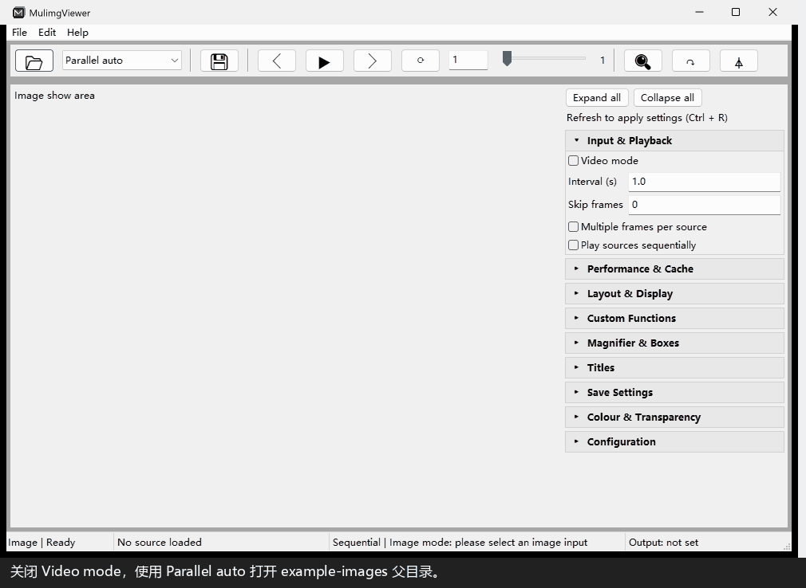
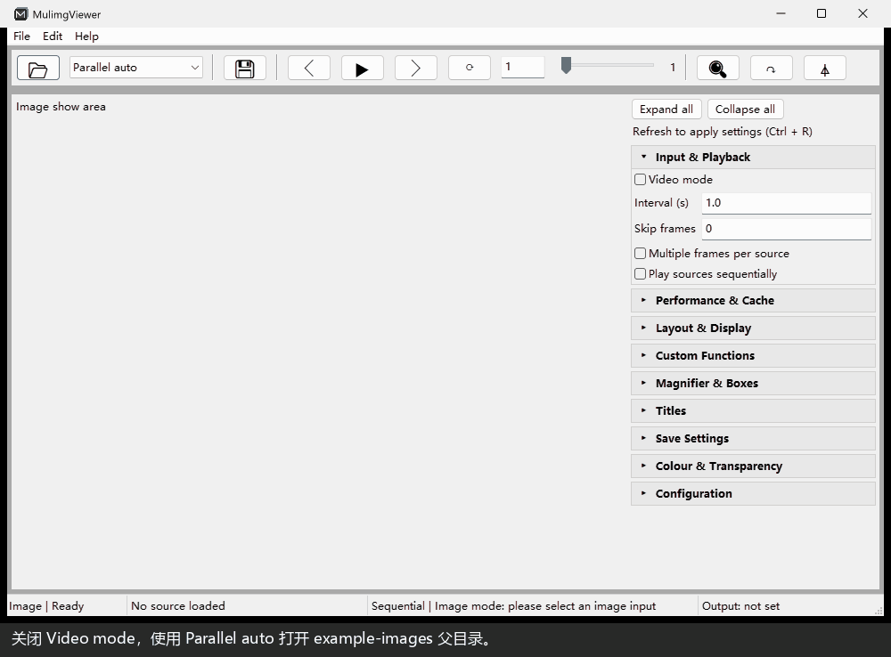
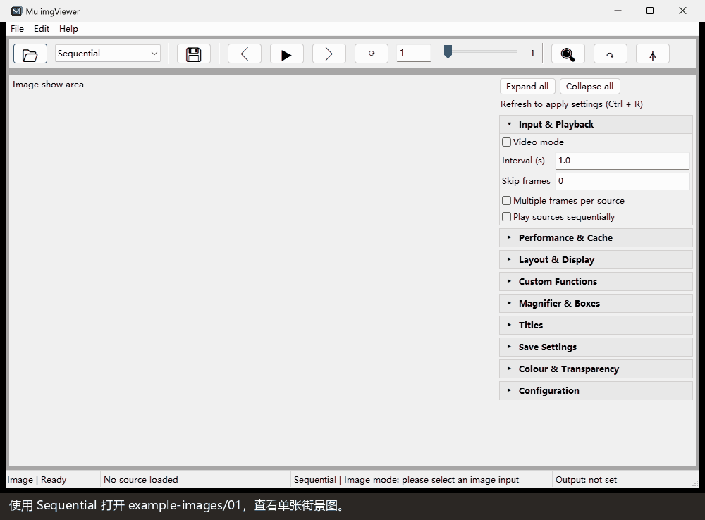
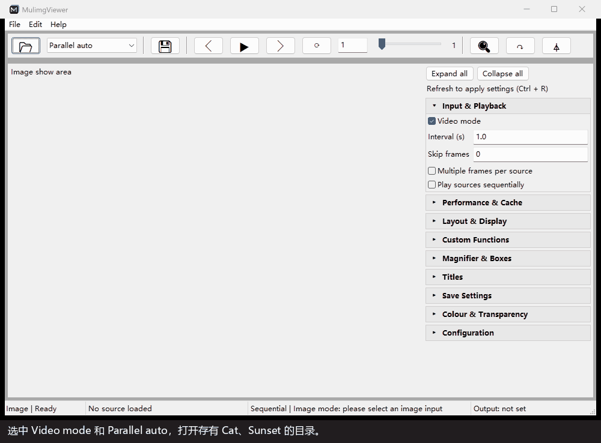

<p align="center">
  
</p>

# MulimgViewer · {{version}}

**多路图像与视频并行浏览器**，适用于 Windows、Linux 和 macOS。

[下载安装](docs/resources/install.md) · [快速入门](docs/resources/usage.md) · [在线中文手册（默认版本）](https://mulimgviewer.readthedocs.io/zh-cn/) · [Online English manual](https://mulimgviewer.readthedocs.io/en/) · [GitHub Releases](https://github.com/nachifur/MulimgViewer/releases)

## 介绍

MulimgViewer 把多个来源排在同一页，让你按相同的位置浏览、比较和挑选图像或视频帧。

- **多路并行浏览。** 多个图像目录或多段视频可以一起翻页；每个来源也能并排显示连续几帧，方便对照前后变化。[输入与播放设置](docs/resources/settings.md#readme-input-playback)
- **同一区域同步放大。** 在一个来源上框出细节，其他来源同时显示对应区域。可以保留多个框，分别观察纹理和边缘。[放大操作示例](docs/resources/usage.md#readme-compare-details)
- **原图与算法结果同屏。** 接入自己的 Python 处理函数，把同一输入的原图与一种或多种算法结果排在一起，逐页查看差异。[自定义函数设置](docs/resources/settings.md#readme-custom-functions)
- **超 4K 原尺寸细节对比。** 在十张图上查看同一位置的原始像素，隐藏全图后仍能读到每个来源的标题。[查看 1:1 无损样图](docs/media/sr-detail-native.png)
- **按位置成组挑图。** 在并行模式下选中一个位置，就能按来源保存对应样本，适合同时挑出原图、标注和预测结果。[挑图规则](docs/resources/usage.md#readme-select-export)
- **按版式导出对比图。** 将标题、取样框和放大细节拼成一张图，支持 JPG、PNG 和 PDF。预览与输出可以分别设置比例。[导出内容与画质](docs/resources/settings.md#readme-save-settings)

下面用两段独立的视频演示并行播放：左侧是猫咪，右侧是日落，向前翻一页，两路画面一起更新。



**试试上图。** 把 [Cat.mp4](docs/media/example-videos/Cat.mp4) 和 [Sunset.mp4](docs/media/example-videos/Sunset.mp4) 放入同一个空目录。勾选 **Video mode**，选择 **Parallel auto** 并打开目录。将 **Page** 设为 `1,2`、**Per source** 设为 `1,1`，关闭 **Multiple frames per source** 和 **Play sources sequentially**，勾选 **Title**。按 **Ctrl+R** 应用，点 **▶** 播放，按 **Esc** 暂停。

## 应用场景

下面七段录屏使用仓库里的[两段视频](docs/media/example-videos)、[两组照片](docs/media/example-images)和一组超 4K 对比图。复现时，在 **Layout & Display** 勾选 **Fit window to image**，按 **Ctrl+R** 应用设置。录屏保留标题栏、工具栏、右侧设置和底部状态栏。

### 例 1 · 在同一页比较多个视频的连续帧

想看清动作从哪一帧开始变化，可以把时间也排进画面。录屏先并排打开 Cat 和 Sunset，再把每路展开为连续三帧。看同一组的三格可以追踪动作，看两组中相同位置的格子可以对照同一时刻。

用 **Parallel auto** 打开上面的两段视频，勾选 **Multiple frames per source**。将 **Page** 设为 `1,2`、**Per source** 设为 `1,3`，保持 **Skip frames** 为 `0`，按 **Ctrl+R**。要复现图中的大小，将 **Display scale** 设为 `0.35,0.35`。


### 例 2 · 给所有来源放大同一处细节

在左图建筑外墙上画一个框，右图的相同坐标也会出现红框。看上排可以确认取样位置，看下排可以比较窗框和斜边的细节。两个来源共用取样位置，只需画一次。

先取消 **Video mode**，用 **Parallel auto** 打开[示例图像目录](docs/media/example-images)。勾选 **Image**、**Magnifier** 和 **Title**，将 **Page** 设为 `1,2`、**Image unit** 设为 `3,1` 后刷新。打开放大工具，在左图上拖出矩形即可。



### 例 3 · 从画面中的一个位置找回原始文件

两张照片都叫 `00.png`，怎样找到右边那张？单击主窗口里的右图，按 **F2** 打开 **Index table**，点 **Go to current ID**。此时选中 **Visual ID 2**，位置是 **Page 1 / Row 1, Col 2**。下方 **Original source** 的末尾是 [02/00.png](docs/media/example-images/02/00.png)，点 **Copy original source** 即可复制完整路径。



### 例 4 · 点一次，把成组样本一起挑出来

还是这两张同名照片，这次要**把整组留下**。用 **Parallel auto** 打开 `example-images`，关闭 **Play sources sequentially**。在 **Save Settings** 指定输出目录，**Content** 选 **Selected images**，**Format** 选 **png**。单击右侧照片确定位置，按 **Ctrl+S**。



看到保存成功后，用 **Parallel auto** 打开输出目录下的 `image/algorithms/original/select_images/`。左右两列分别来自 `01/00.png` 和 `02/00.png`：只选了一个位置，两个来源的照片都已保存。

### 例 5 · 展示自定义函数的处理效果：原图与高斯模糊对照

高斯模糊抹去了多少窗框细节？用 **Sequential** 打开 `example-images/01`，以**同一张街景图**作输入。录屏从单张原图开始，加入内置 **Gaussian Blur** 后左右对照，再对窗框取样、保存。放大后，左侧细线清晰可见，右侧边缘已经变宽。



在 **Custom Functions** 中选择 **Gaussian Blur**，勾选 **Selected** 和 **Show original panel**。将 **Algorithms** 设为 `1,2` 并刷新，即可左右比较。需要保留画面时，将 **Save Settings → Content** 设为 **Stitch**，指定输出目录后按 **Ctrl+S**。也可以[接入自己的 Python 函数](docs/dev/dev.md)，用相同布局检查处理结果。

### 例 6 · 用五层网格，把多维对比排在一张二维画布上

两段视频、每路两个连续帧，每帧取两处细节，还要比较处理前后，怎样一眼看出哪两格应该对照？MulimgViewer 的做法是让**位置表达含义**。五层网格各自设置行数和列数，共有 **5 组 × 2 个行列参数**。下面这组排法，可以从外到内阅读：

| 网格层级 | 行,列 | 这张画布怎么读 |
| --- | --- | --- |
| **Algorithms** | `2,1` | 上半页是原图，下半页是 Gaussian Blur；同一位置上下对照。 |
| **Page** | `1,2` | 每个算法面板内，左组是 Cat，右组是 Sunset。 |
| **Per source** | `1,2` | 每组横排两个连续帧，沿时间看变化。 |
| **Image unit** | `3,1` | 每帧从上到下放完整画面、局部放大区和标题。 |
| **Magnifiers** | `1,2` | 放大区内并排显示两个取样框，各帧使用相同的取样位置。 |



**跟着做。** 用 **Video mode → Parallel auto** 打开示例视频目录，勾选 **Multiple frames per source**。在 **Layout & Display** 按表填写五组行列，勾选 **Image、Magnifier、Title**，将 **Display scale** 设为 `0.3,0.3` 并刷新。开启放大工具，在第一帧拖出一个框，再在另一处右键选 **Create zoom box here**。最后在 **Custom Functions** 选 **Gaussian Blur**，勾选 **Selected** 和 **Show original panel**，按 **Ctrl+R**。

这页同时呈现 **2 个算法面板 × 2 路来源 × 2 帧，共 8 个整帧视图及 16 个局部视图**。看时间变化时横读同组的相邻帧，看处理差异时上下对照同一格，看细节时对准同一个框。翻页后对应关系仍在，导出 **Stitch** 也会保留这套排布。[五层网格与间距设置](docs/resources/settings.md#readme-layout-display)

### 例 7 · 十张超 4K 图像，只看同一处 1:1 原始像素

鸟喙边缘的阶梯、羽毛上的细纹，缩成整图预览后很难分辨。在参考图上画一次框，隐藏 **Image**，保留 **Magnifier** 和 **Title**，将 **Display scale** 与 **Zoom scale** 都设为 `1,1` 后刷新。两行五列同时呈现十张 4608 × 2592 图像的同一块 160 × 160 区域。


第一格是参考图，其余九格是同一输入的插值结果。录屏用于跟做；要检查像素，请打开[无损结果 PNG](docs/media/sr-detail-native.png)，按 100% 查看。[复现步骤](docs/resources/large-images.md) · [生成示例数据](docs/media/make_sr_example.py)

## 用户交流

QQ 交流群：**945669929**。可扫描下方二维码加入。


## 引用与使用条款

```bib
@software{MulimgViewer,
  author  = {Liu, Jiawei},
  license = {GPL-3},
  title   = {{MulimgViewer: A multi-image viewer for image comparison and image stitching}},
  url     = {https://github.com/nachifur/MulimgViewer}
}
```

在研究中使用 MulimgViewer 时，可通过 GitHub 的 **Cite this repository** 获取引用，作者与项目信息见 [CITATION.cff](CITATION.cff)。许可证见 [LICENSE](LICENSE)。商业使用请联系项目作者 liujiawei18@mails.ucas.ac.cn。

[更新记录](CHANGELOG.md) · [提交问题或建议](https://github.com/nachifur/MulimgViewer/issues)
