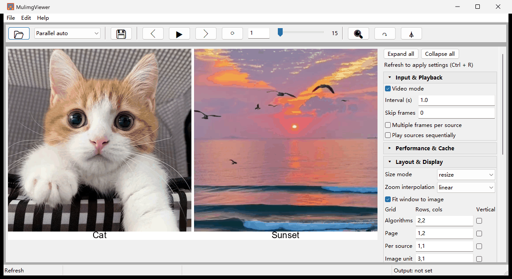

# MulimgViewer 中文手册

把多个来源的同一位置排在一页上，可以逐帧比较视频、放大同一区域，也可以并排查看算法处理前后的差异。这里介绍当前源码版，已发布的安装包请对照相应版本的手册。



**第一次使用**可以先完成[安装与自检](resources/install.md)，再用随手册提供的猫咪和海上日落片段跟做[并行播放示例](resources/usage.md)。要添加处理算法或提交代码，请看[开发指南](dev/dev.md)。

```{toctree}
:maxdepth: 2
:caption: 使用与开发

resources/install
resources/usage
resources/settings
dev/dev
```

```{toctree}
:hidden:
:caption: 项目记录

misc/changelog
misc/acknowledgements
misc/todo
```
