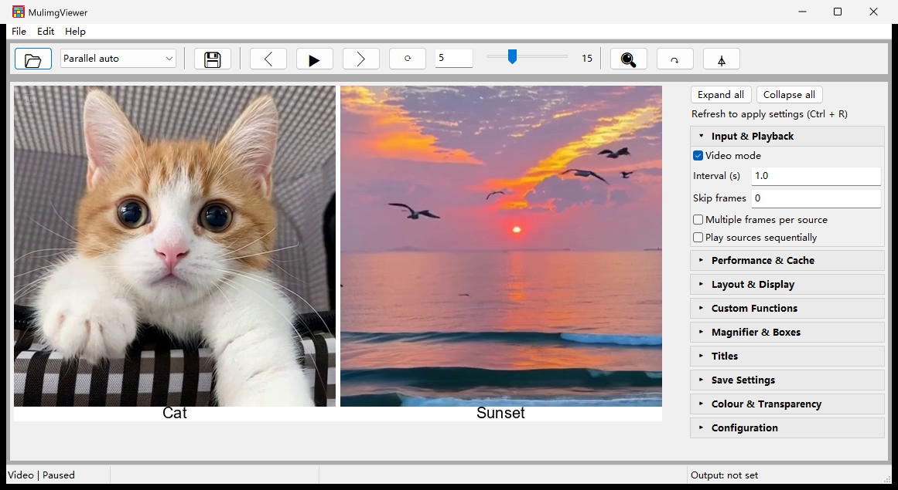

# 下载与安装

## 下载适合当前系统的桌面包

[打开 GitHub Releases 下载软件](https://github.com/nachifur/MulimgViewer/releases)。

在发布页打开对应版本的 **Assets**。Windows 选 Windows 包，macOS 注意区分 Apple 芯片与 Intel，Linux 选择与处理器架构一致的包。如果该版本只提供 **Source code**，请使用下方的源码安装步骤。

## 解压并启动

完整解压软件包并进入 MulimgViewer 目录。Windows 双击 `MulimgViewer.exe`，Linux 和 macOS 在图形桌面的终端执行 `./MulimgViewer`。移动软件时请保留整个目录，包括其中的依赖文件。

离线包自带 Python、wxPython、FFmpeg 和 FFprobe。可在该目录下运行 `.\MulimgViewer.exe --self-check`（Windows PowerShell）或 `./MulimgViewer --self-check`（Linux、macOS）验证窗口、视频解码、内置算法以及 PNG、PDF 和 Excel 导出。

对于 `.tar.xz` 包，在空目录中执行 `tar -xf 软件包路径` 即可解压。

## 运行当前源码版

以下命令适用于 Windows、Linux 和 macOS。先安装 Git 和 Conda，在终端（Windows 可用 Anaconda Prompt）执行：

```sh
git clone https://github.com/nachifur/MulimgViewer.git
cd MulimgViewer
conda env create -f environment.yml
conda activate mulimgviewer
python tools/check_video_tools.py
python MulimgViewer.py
```

已有仓库时，从项目根目录的第三条命令开始；已有可用环境时，从激活环境开始。`environment.yml` 指定 Python 3.11，由 conda-forge 安装 wxPython、FFmpeg 和 PyAV。以后启动只需激活同一环境，在仓库根目录执行最后一条命令。

## 验证安装

| 检查 | 怎么做 | 应该看到什么 |
| --- | --- | --- |
| 图形界面 | 启动程序，选择 Sequential，打开 `auto_test_scripts/assets/images/source_001` | 能显示图像并翻页 |
| 视频工具 | 运行 `python tools/check_video_tools.py` | 列出当前解释器、FFmpeg 和 FFprobe 的路径，两个程序均可执行 |
| 多视频播放 | 按[双视频示例](usage.md)打开 Cat 和 Sunset，翻到下一页 | 两个标题仍在各自画面下，两路视频同时前进 |



如果提示找不到 FFmpeg 或 FFprobe，在当前环境执行 `conda install -c conda-forge ffmpeg`，再运行检测脚本。在 IDE 中调试时，选择检测脚本输出的同一个 Python 解释器。使用自行安装的工具时，可用环境变量 `FFMPEG_BINARY`、`FFPROBE_BINARY` 分别指定两个可执行文件的完整路径。

如果 Linux 上安装 wxPython 时提示缺少 GTK，先确认已用仓库的 Conda 环境安装原生依赖。macOS 如提示 wxPython 需要框架启动器，可在该环境安装 `conda install -c conda-forge python.app`，然后用 `pythonw MulimgViewer.py` 启动。
