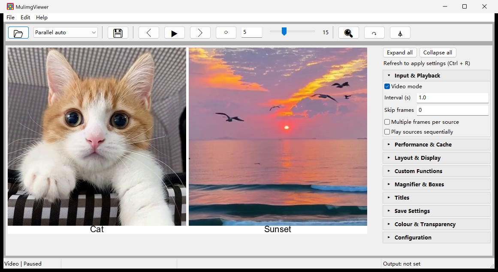

# 工具栏、菜单与快捷键

主窗口顶部的 **Language** 菜单用各语言的本地名称列出选项，选择后立即切换。首次启动和恢复默认设置使用英语。关闭时会保存当前语言，手动保存和加载配置也会保存和恢复这项选择。下图为英文界面。

## 工具栏从左到右怎么用

| 位置或图标 | 操作 |
| --- | --- |
| 文件夹 · 输入模式下拉框 | 先选输入模式，再点左侧文件夹。视频输入还需勾选 **Video mode**。四种输入方式的素材要求见[浏览指南](usage.md)。 |
| 软盘 | 按 **Save Settings** 导出。首次使用先指定输出目录。右侧 **Configuration → Save** 用于保存设置。 |
| 左箭头 · 播放 · 右箭头 | 单击箭头翻一页。播放沿最近一次翻页方向继续；想倒放时先点左箭头再点播放。再次点播放或按 Esc 可暂停。 |
| 环形箭头 ⟳ | 刷新。一次应用积累的布局、显示、算法和缓存修改。 |
| 数字框 · 滑块 · 末尾数字 | 输入页码后按 Enter 精确跳页，或拖动滑块浏览。页码从 1 起，最右数字是总页数。一页可以包含多个来源和多个帧。 |
| 放大镜 | 切换画框工具，左键拖出矩形。要看放大内容，还需开启 **Layout & Display → Magnifier** 并刷新。 |
| 弯箭头 ↷ · 镜像 ⏃ | 先启用工具，再单击目标图。每次点击顺时针旋转 90° 或左右翻转。放大、旋转、镜像三个工具互斥；用完再点已启用的按钮退出。 |

**旋转和镜像会写文件。** 图像模式会在被点中图像的文件路径写回，编码取自当前保存格式；处理珍贵原图前请先复制。视频模式操作的是已拆出的缓存帧，缓存重新生成后修改可能消失。

## File：打开输入和复用来源清单

| 菜单项 | 默认按键与用途 |
| --- | --- |
| Open → Sequential / Parallel auto | **Ctrl+E** 打开单个来源；**Ctrl+A** 打开并自动发现并行来源。 |
| Open → Parallel manual / Image File List | **Ctrl+M** 手动选择来源；**Ctrl+F** 打开图像或视频文件清单。 |
| Select output path | **Ctrl+O** 选择输出目录。 |
| Save flist / Input flist – Parallel manual | 手动选好一组图像目录后，**Ctrl+P** 将目录列表写到输出目录的 `input_flist_parallel_manual.txt`；**Ctrl+I** 读回这份目录列表。要逐项打开图片或视频文件，请用 Ctrl+F。 |

## Edit 与 Help：默认快捷键

| 命令 | 默认按键与用途 |
| --- | --- |
| Next / Last | **Ctrl+N / Ctrl+L** 下一页 / 上一页。 |
| Save / Refresh / Hidden | **Ctrl+S** 导出，**Ctrl+R** 应用修改，**Ctrl+H** 收起或恢复顶部工具栏和右侧设置区。 |
| Pause saving / playback · Cancel saving | **Esc** 暂停正在播放的视频或图像，也暂停正在进行的批量保存；两者同时进行时会一起暂停。点播放或保存可分别继续。要结束本次保存，选择 **Edit → Cancel saving**。 |
| Up / Down / Left / Right | **方向键**平移超出窗口的画布；在选框模式中移动选中的框。编辑参数时方向键交给文本框，点回图像区即可恢复画布操作。 |
| Delete box | **Delete** 在 **Select individual box** 模式删除选中的框；关闭该模式时会清除全部框。 |
| Index table / About | **F2** 打开索引表；**F1** 打开关于窗口。 |

表中列出默认配置。加载过自定义快捷键后，以当前菜单项旁显示的按键为准。

## 右键菜单与底部反馈

鼠标在图像区时，滚轮可上下移动画布，Shift 加滚轮可横向移动。开启工具栏放大镜后，Ctrl 加滚轮会改变 **Display scale** 并刷新整页。要精确检查 1:1 局部，请按[使用技巧](large-images.md)设置显示与放大比例。

右键目标图可直接刷新、翻页、保存，或用 **Select image** 按点击位置挑图。放大镜开启后可追加同尺寸框；已有框时可清空，选中单框后可移动或删除该框。填写 **Rename** 旁的文字后，右键菜单还会出现 **Inject title**，仅作用于点中的图。挑图范围和输出示例见{ref}`挑图和导出 <select-export>`。

单击画面后，从左到右读状态栏：第一栏是当前模式和运行状态；第二栏是页码、来源内的位置及已选框；第三栏是输入模式、来源路径和视频时间；第四栏是输出目录或保存进度。路径被截断时将鼠标悬停在对应栏；要复制路径，按 **F2**。
