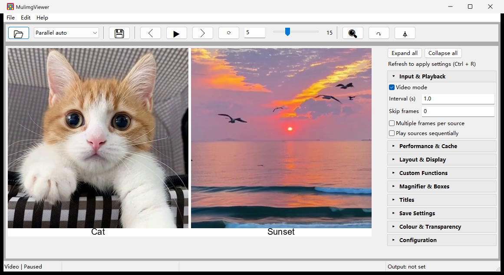
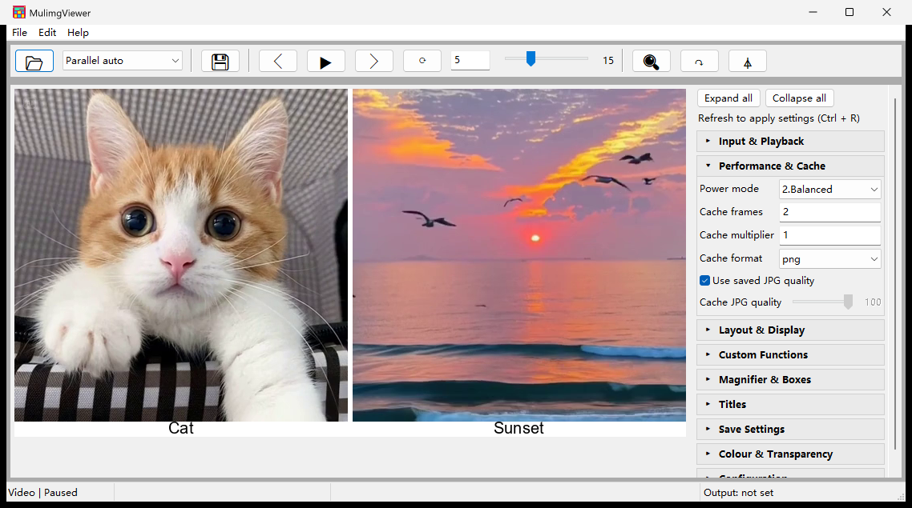
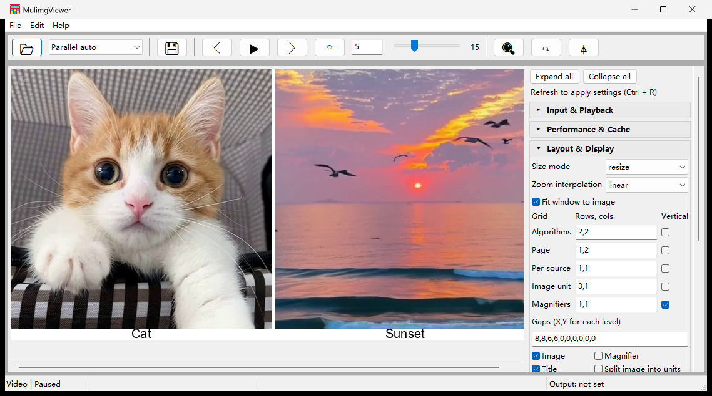
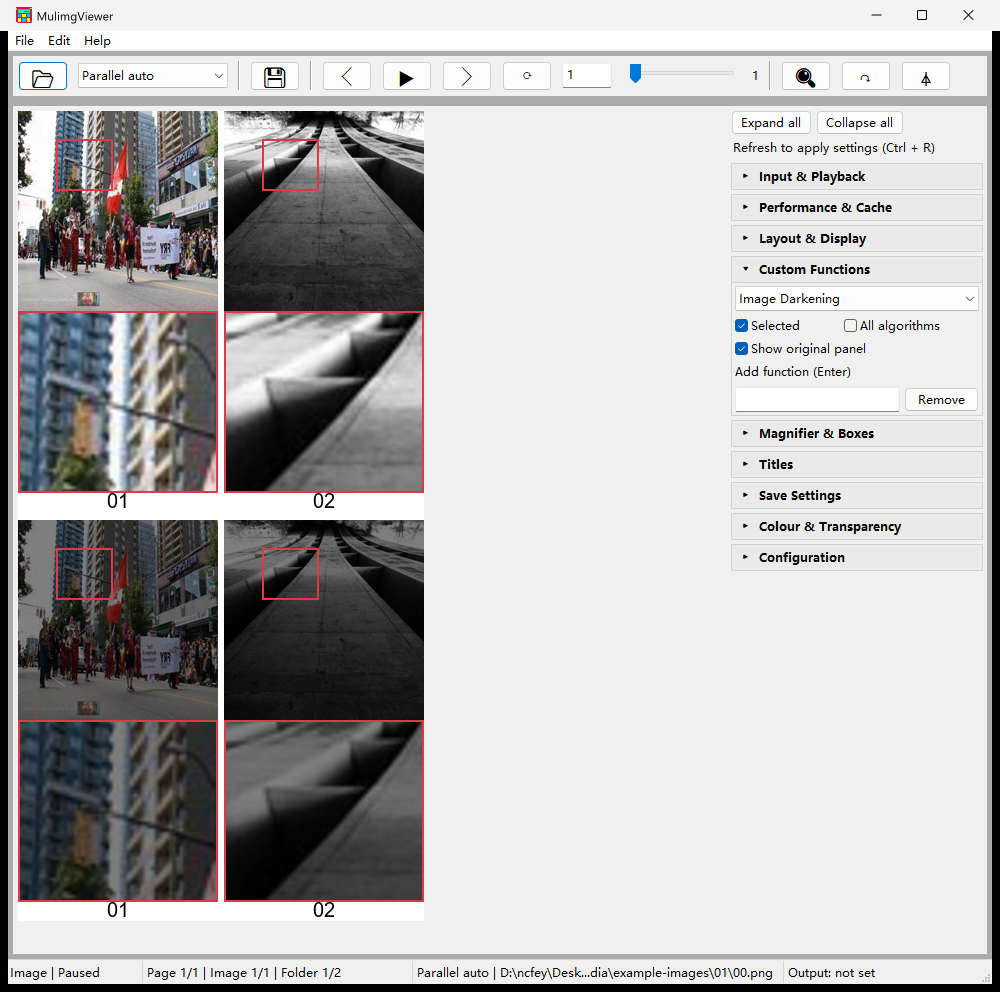
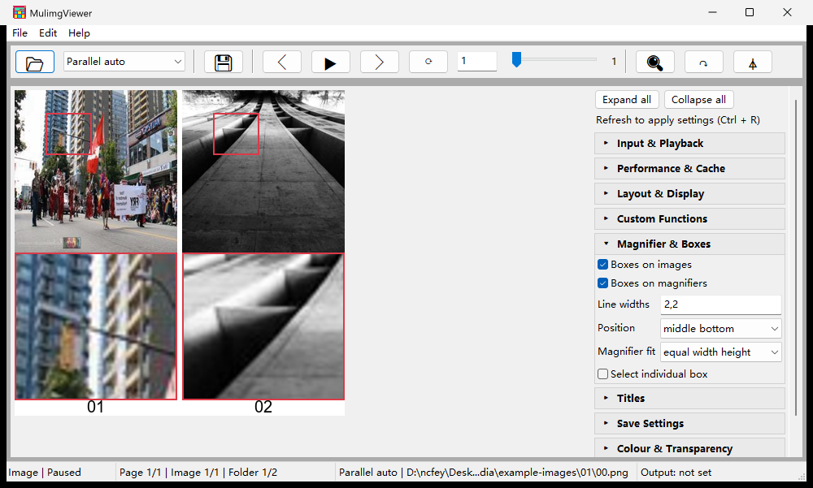
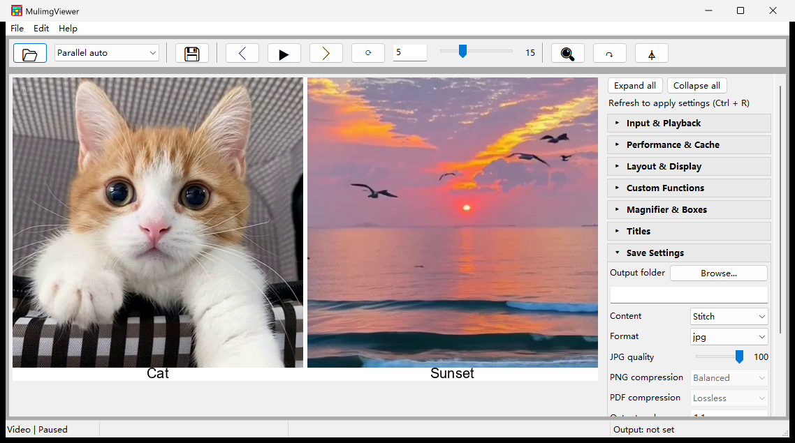
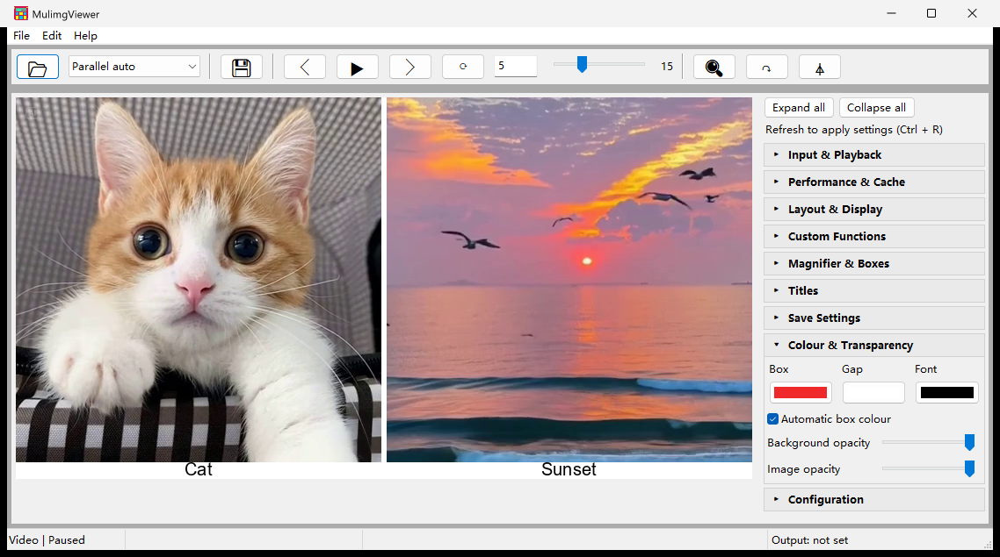
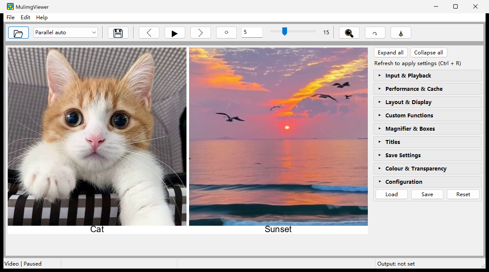

# 右侧设置栏

从工具栏选择输入模式，点击文件夹图标打开来源。右侧分组可点击标题展开；用 **Expand all / Collapse all** 展开或收起全部。设置较多时可滚动右栏，或拖动与图像区之间的分隔条。下面的截图均为运行中的完整主窗口。

先设置同一组相关参数，再按 **Ctrl+R** 一次应用布局、算法和缓存编辑。**Power mode** 切换运行预算；工具栏保存按钮使用点击时的导出设置。截图均已勾选 **Layout & Display → Fit window to image** 和 **Title**，并启用 **Titles → Auto title**；刷新后窗口会按画布调整。要跟做示例，先打开[使用指南](usage.md)中对应的输入目录。

## Input & Playback｜来源顺序和播放节奏

| 控件 | 设置方法 |
| --- | --- |
| Video mode | 打开视频前勾选，浏览图像前取消。再从工具栏选择输入模式并打开来源。 |
| Interval (s) | 手动输入希望的最短翻页间隔，例如 `1.0` 表示至少停留一秒。供给不足时，实际间隔可以更长。 |
| Skip frames | 两个采样帧之间跳过的视频帧数。填 `0` 逐帧查看；填 `1` 每隔一帧取一帧。 |
| Multiple frames per source | 并行来源各自连续显示多项。要同时查看每路的三个位置，在 Layout & Display 将 **Per source** 设为 `1,3`。 |
| Play sources sequentially | 按来源依次浏览，例如先看完视频 A 再进入 B。这两个复选框互斥；要让两路视频始终并排、每路一帧，两项都取消。 |

## Performance & Cache｜速度、内存和画质

- **Power mode** 提供 Eco、Balanced、Performance、Maximum 四档。先用 Balanced；在持续播放时悬停查看播放与供给 FPS、CPU、内存和活动任务，再决定是否提高预算。
- **Cache frames** 是当前页附近优先准备的半径，**Cache multiplier** 扩展外层半径，两项均填至少为 1 的整数。例如 `2` 和 `3` 对应内层 2 页、外层 6 页；靠近首尾时仅缓存有效页。
- **Cache format** 选 `jpg` 可减少磁盘占用，`png` 可避免缓存阶段的 JPG 损失，`auto` 按导出格式和比例选择。勾 **Use saved JPG quality** 时沿用导出质量，取消后可单独调节 **Cache JPG quality**。

## Layout & Display｜画布怎么排

**Rows, cols** 先填行、再填列；右侧 **Vertical** 改为按列填充。**Size mode** 可选 resize、crop、fill；**Zoom interpolation** 控制放大区的插值方式。**Fit window to image** 在刷新时按画布调整窗口。

| 网格 | 管什么 | 示例 |
| --- | --- | --- |
| Algorithms | 每种算法的整幅拼接图占一格 | `2,1` 上下对照原图与一种算法 |
| Page | 页面主网格 | `1,2` 左右对比；`-1,-1` 自动计算 |
| Per source | 每个来源的连续项 | 配合 **Multiple frames per source** 使用 |
| Image unit | 一项内部的显示单元 | 演示取 `3,1`，为图像、放大区和标题留出位置 |
| Magnifiers | 多个框的放大图 | 两个框可用 `1,2` 横排 |

**Gaps (X,Y for each level)** 按上表顺序给五对水平、垂直间距。**Image / Magnifier / Title** 决定哪些内容出现；单张输入已包含多个小图时可用 **Split image into units**，共用标题时选 **Shared title**。

**Display scale / Zoom scale** 填水平、垂直比例；**Image size / Zoom size** 填宽、高像素。`-1,-1` 在尺寸框中表示自动。需要固定放大图尺寸时使用 **Keep zoom size**。导出比例在 Save Settings 单独设置。

## Custom Functions｜对比原图和算法

在下拉框选 **Image Darkening**，勾 **Selected** 和 **Show original panel**，将 **Layout & Display → Algorithms** 设为 `2,1` 后刷新。上排显示原图，下排显示同一输入变暗后的结果。要比较更多算法，改选 **All algorithms**，并给网格留足位置；超出容量的算法不会进入这次处理。**Add function (Enter)** 输入名称后回车，**Remove** 移除选中的算法。编写算法见[开发指南](../dev/dev.md)。

## Magnifier & Boxes｜框与放大区

显示放大区需要先勾选 **Layout & Display → Magnifier**。打开放大工具，在图像上拖出矩形。**Boxes on images** 和 **Boxes on magnifiers** 分别控制两处框线。**Line widths** 填两处线宽；**Position** 选择放置位置，例如 **middle bottom** 为底部居中。**Magnifier fit** 可按等宽、等高或等宽高排列。要调整已有框，勾选 **Select individual box** 后单击该框，用方向键微调。

## Titles｜选择标题字段

视频示例画布上显示 Cat 和 Sunset。先在 **Layout & Display** 勾 **Title** 才能看到标题。**Auto title** 根据输入来源生成标题。若要手动选择内容，取消它，再选择 **Parent**（父目录）、**Prefix / Name / Suffix**（文件名组成部分）或 **EXIF**。**Below** 将标题放在图片下方，**Alignment** 控制对齐，**Font size / Font** 控制字号和字体。为单张图显示自定义文本时，填写 **Rename** 旁的文本，右键目标图注入，再开启 **Rename**。修改字体颜色见 Colour & Transparency。

## Save Settings｜导出内容和质量

1. 在 **Output folder** 点击 **Browse…** 选目录。在 **Content** 选择 **Stitch**（拼接）、**Selected images**（挑图）、**Magnifiers**（放大区域），或选包含多项的组合。
2. **Format** 选 jpg、png 或 pdf。对应设置为 **JPG quality**、**PNG compression**、**PDF compression**。PNG 的 Fast、Balanced、Smaller file 调整编码速度与体积；PDF 的 Lossless 和 Compact (JPG) 决定图片嵌入方式。
3. **Output scale** 控制主图输出比例，**Zoom output scale** 控制放大图。填 `1,1` 保留已配置的尺寸。点击工具栏保存按钮导出当前结果。
4. 勾 **Save all pages** 后保存整批，按 **Esc** 暂停，再点保存继续。**Move files** 用于移动挑中的源图，视频模式禁用。组合输出没有放大框时会跳过放大项，仍会保存勾选的拼接或挑图结果。

## Colour & Transparency｜颜色和透明度

**Box** 设置框线颜色，**Gap** 设置画布间隙颜色，**Font** 设置标题颜色。希望自己指定框色时，先取消 **Automatic box colour**。**Background opacity** 控制画布背景，**Image opacity** 控制图像内容；`0` 为透明，`255` 为完全不透明。需要透明背景时，保留图像不透明，降低背景不透明度，并使用支持透明通道的 PNG 导出。JPG 会把透明区域合成到 Gap 颜色上。

## Configuration｜记住或恢复一套设置

| 操作 | 何时用 |
| --- | --- |
| Save | 布局、缓存和导出参数调好后，手动保存一套可复用的设置，也会记录分组折叠状态与右栏宽度。 |
| Load | 尝试其他参数后，找回手动保存的那套设置。 |
| Reset | 恢复默认参数、分组折叠状态和自动栏宽。手动保存的快照仍可用 Load 取回。 |

正常关闭后再启动会恢复上次使用状态。这里的 **Save** 保存配置；工具栏上的磁盘图标导出图像。
