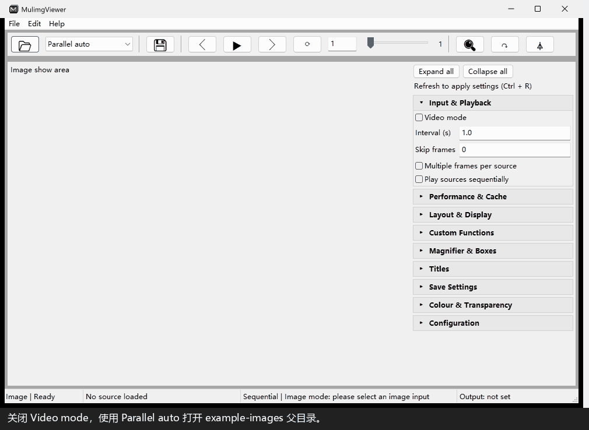
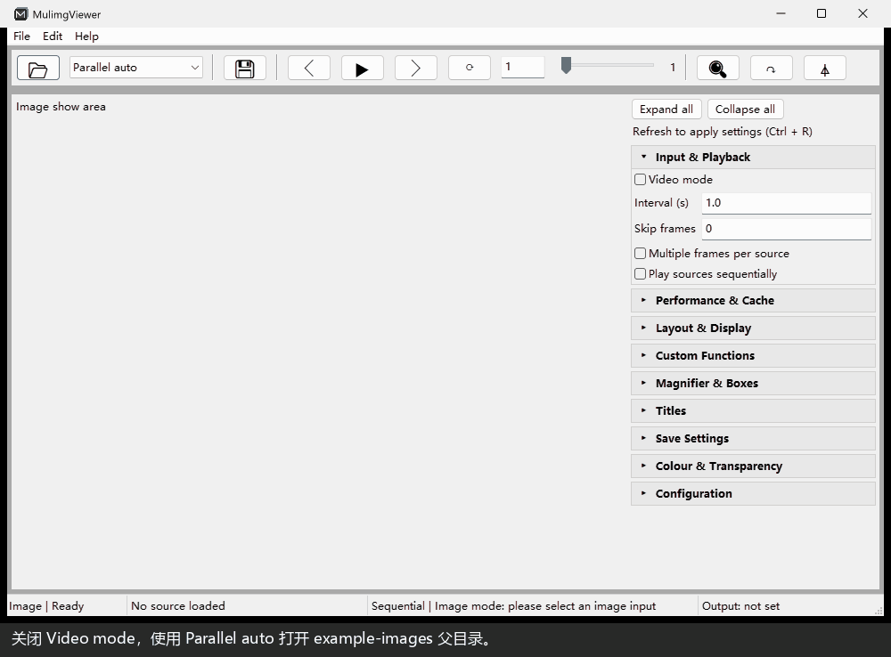
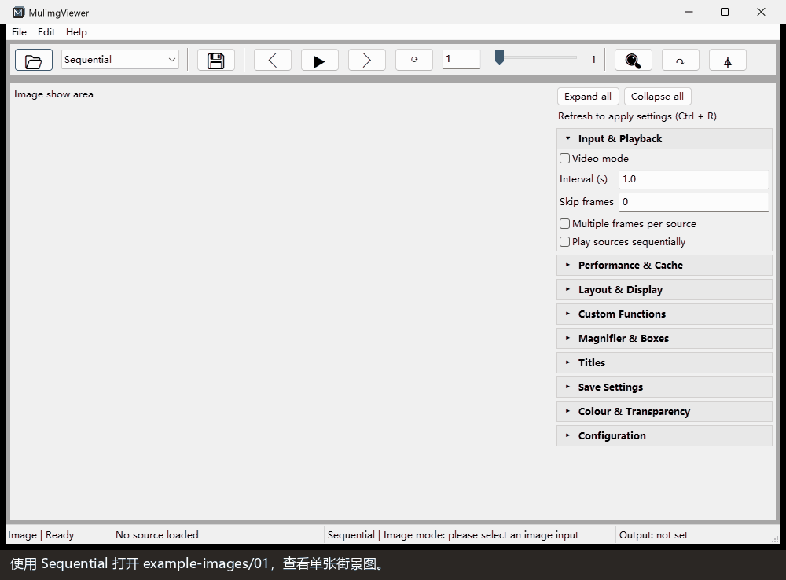
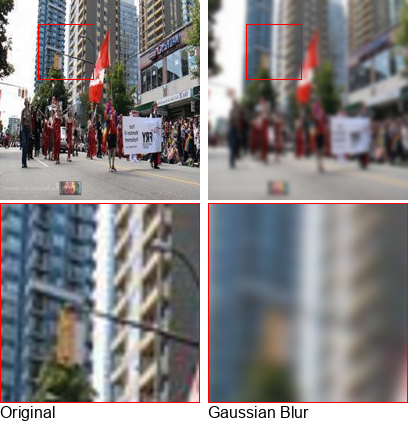

# 图像与视频浏览

## 第一次并排播放两段视频

录屏保留窗口标题栏、工具栏、设置区和状态栏。首次跟做时，若已有自己的配置，可在 **Configuration** 点 **Save** 留一份快照，再点 **Reset** 从默认布局开始；结束后点 **Load** 取回。开启 **Fit window to image** 和 **Title**，保留 **Auto title**。每个案例给出输入模式和需改的参数，改完按 **Ctrl+R**。控件位置见[设置栏参考](settings.md)。

1. 展开右侧 **Input & Playback**，勾选 **Video mode**。在工具栏选择 **Parallel auto**。
2. 在 **Layout & Display** 将 **Page** 设为 `1,2`（一行两列），**Per source** 设为 `1,1`。在 **Input & Playback** 取消 **Multiple frames per source** 和 **Play sources sequentially**。
3. 点击工具栏的文件夹，选择仓库中的 `docs/media/example-videos`。按 **Ctrl+R** 应用布局。左格为猫咪（Cat.mp4），右格为海上日落（Sunset.mp4）。在线阅读时可下载 [Cat.mp4](../media/example-videos/Cat.mp4) 和 [Sunset.mp4](../media/example-videos/Sunset.mp4)，放入同一空目录后打开。
4. 点 **>** 后点 **▶** 向前播放；点 **<** 后再点 **▶** 则向后播放。按 **Esc** 暂停。页码从 1 开始，可用滑块跳转。修改多个布局或算法参数后，统一刷新即可。

要复现动图的尺寸，在 **Layout & Display** 将 **Display scale** 设为 `1,1`（两个演示片段均为 416 × 416），**Gaps (X,Y for each level)** 填 `8,8,6,6,0,0,0,0,0,0`，勾选 **Image**、**Title** 和 **Fit window to image**，取消 **Magnifier**，在 **Titles** 保留 **Auto title**，再按 **Ctrl+R**。画布中应出现 Cat、Sunset 两个标题；较矮的窗口可滚动右栏查看其余参数。动图逐页展示前五页，帧间停留时间用于阅读。

## 选对输入和布局

| 工具栏模式 | 图像输入 | 视频输入 | 适用场景 |
| --- | --- | --- | --- |
| Sequential | 单个图像目录 | 单个视频文件 | 浏览一组照片或检查一个视频 |
| Parallel auto | 含多个来源子目录的父目录 | 含多个视频的目录 | 同一位置对照；图像来源宜使用对应文件名 |
| Parallel manual | 逐个选择来源目录 | 逐个选择视频 | 只比较部分来源或调整来源顺序 |
| Image/Video File List | 指定图片清单 | 指定视频清单 | 重现固定输入。可从仓库的 `auto_test_scripts/assets/lists/` 打开 TXT 示例，相对路径以清单所在目录为基准；也支持 CSV |

**Page** 控制每页的行列，`-1,-1` 请求自动布局。**Multiple frames per source** 可在每个来源内连续显示多项，例如 **Per source** 为 `1,3` 时横排三个位置；**Play sources sequentially** 把来源串起来依次浏览。后者也改变挑图范围。

### 在同一页比较连续帧

继续使用 Cat 和 Sunset。勾选 **Multiple frames per source**，关闭 **Play sources sequentially**。保持 **Page** 为 `1,2`，将 **Per source** 设为 `1,3`、**Display scale** 设为 `0.35,0.35`、**Skip frames** 设为 `0`。按 **Ctrl+R** 后翻页。左边三格来自 Cat，右边三格来自 Sunset，每组三个帧号连续。

(compare-details)=
## 给两个来源放大同一处细节

复现下图：取消 **Video mode**，用 **Parallel auto** 打开仓库的 `docs/media/example-images`。其中两个子目录各有一张 200 × 200 图片。在线阅读时也可下载 [来源 01](../media/example-images/01/00.png) 和 [来源 02](../media/example-images/02/00.png)，分别存为 `example-images/01/00.png` 与 `example-images/02/00.png`。将 **Page** 设为 `1,2`、**Image unit** 设为 `3,1`、**Display scale** 设为 `1,1`，勾选 **Image**、**Title** 和 **Fit window to image**，保留 **Auto title**，按 **Ctrl+R**。两项的标题分别为来源目录名 01 和 02。

开启 **Layout & Display → Magnifier** 后刷新，点工具栏放大镜。在左图建筑外墙上按住鼠标拖出矩形并松开。两张图会同时出现框，下方各显示来自自己来源的局部。

## 找到某一张图

用 **Parallel auto** 打开上例的 `example-images`，将 **Page** 设为 `1,2`。两张照片都叫 `00.png`。单击右图，按 **F2** 打开索引表，在 **Visual items** 中点击 **Go to current ID**。选中的应是 ID 2（第 1 页、第 1 行、第 2 列），**Original source** 末尾应为 `02/00.png`。点击 **Copy original source** 可复制路径。

双击索引行可跳回对应页。要按页或按来源查找，切换到 **Pages** 或 **Sources**。视频帧路径可能先于文件生成；可将当前视图导出为 Excel。

(select-export)=
## 挑图和导出

在 **Save Settings** 选择输出目录、输出模式、格式和比例。点击工具栏保存图标或 **Ctrl+S** 后，后台按点击时的设置生成文件，右侧状态栏显示进度。

| 输出选项 | 得到什么 |
| --- | --- |
| Stitch | 最终画面在 `composed`，各算法的拼接图在 `algorithms/<算法>/stitch_images` |
| Selected images | 选择结果在各算法的 `select_images` 中，按来源归档 |
| Magnifiers | 输出放大区域和带框图。组合模式下，没有框会跳过这一项，其他已选输出照常保存 |

**挑选规则。** 单击确定位置，再保存 **Selected images**；右键 **Select image** 是该操作的快捷方式。Parallel auto/manual 会从各来源选同一位置，在 Multiple frames per source 下会保留点中的来源内偏移。Sequential、File List 和 Play sources sequentially 只挑当前项；显示算法时也可输出相应处理结果。图像模式的移动选项会移动源文件，首次尝试建议使用副本；视频模式不会移动源视频。

**跟做一次并行挑图。** 用 **Parallel auto** 打开 `example-images`，关闭 **Play sources sequentially** 和 **Move files**。选择空输出目录，**Content** 选 **Selected images**，**Format** 选 **png**。点右图后按 **Ctrl+S**。等右下角提示保存成功，再用 **Parallel auto** 打开输出中的 `image/algorithms/original/select_images`。应同时看到来自 01 和 02 的照片。

导出画质和暂停批量保存见{ref}`保存设置 <export-settings>`。

## 用同一张原图检查算法效果

取消 **Video mode**，用 **Sequential** 打开 `example-images/01`。选择 **Gaussian Blur**，勾选 **Selected** 和 **Show original panel**。将 **Algorithms** 设为 `1,2`、**Page** 设为 `1,1`，刷新。左右两格现在来自同一张街景照片。开启 **Magnifier** 并刷新，在窗框上取样，比较左侧原图的细线和右侧平滑后的边缘。录屏最后选择 **Stitch** 和 **png**，指定输出目录，按 **Ctrl+S** 导出。

导出的拼接 PNG 如下。上排对照整图，下排对照同一个窗框；图中保留了来源标题和取样框。

## 在一页对齐算法、来源、时间和局部细节

用 **Video mode → Parallel auto** 打开 Cat 和 Sunset，勾选 **Multiple frames per source**。在 **Layout & Display** 从上到下将 **Algorithms、Page、Per source、Image unit、Magnifiers** 设为 `2,1`、`1,2`、`1,2`、`3,1`、`1,2`。勾选 **Image、Magnifier、Title**，将 **Display scale** 设为 `0.3,0.3` 后刷新。在猫咪图上拖出第一个放大框，再到另一处右键选 **Create zoom box here**。选中 **Gaussian Blur**，勾选 **Selected** 和 **Show original panel** 后刷新。

核对最后的画面：上下比较处理前后，每排左边是 Cat，右边是 Sunset。每个来源有两帧，每帧下方并列两个局部。这样一页共有 8 个整帧视图和 16 个局部视图；翻页后，同一位置仍可对应比较。

## 播放卡顿时看什么

把鼠标放在 **Performance & Cache → Power mode** 上，对比实际播放 FPS 与供给 FPS（后台产出可显示页面的速度）。每秒显示一页可以同时更新多路视频，不能把页率乘以来源数当作单路帧率。

| 现象 | 可先调整 |
| --- | --- |
| 播放均匀，但比预期慢 | 查看 **Interval (s)**。手动设定是切换间隔的下限，例如 1 秒最多约每秒翻一页；需要更快时先减小它 |
| 跳转后首屏慢，随后恢复 | 跳到长视频深处需要寻帧并准备当前页；先用较小预览比例，比较各来源的分辨率和编码 |
| 供给持续跟不上 | 从 Balanced 切到 Performance 或 Maximum；如果仍受限，减小预览尺寸、可见算法数或每页图像数 |
| 大体流畅，偶尔等下一页 | **Cache frames** 控制近区，乘以 **Cache multiplier** 得到外层范围。适当增大可利用空闲资源提前准备，代价是更多磁盘读写和空间 |

Eco、Balanced、Performance、Maximum 提供不同的 CPU 和内存预算。持续速度还取决于解码、算法、拼接和磁盘。缓存会随浏览位置更新；需要长期保留的结果请导出。
