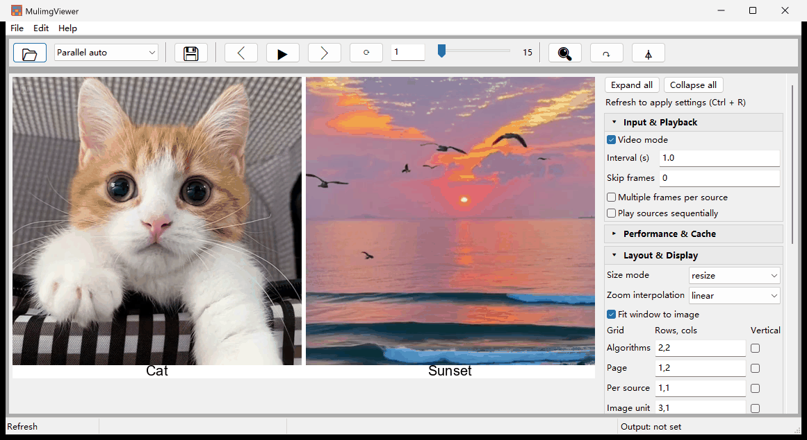
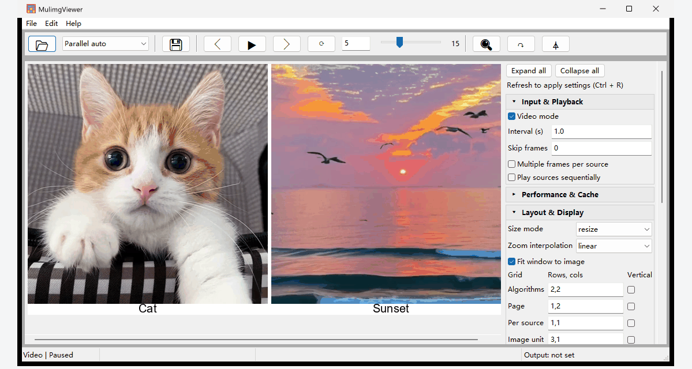
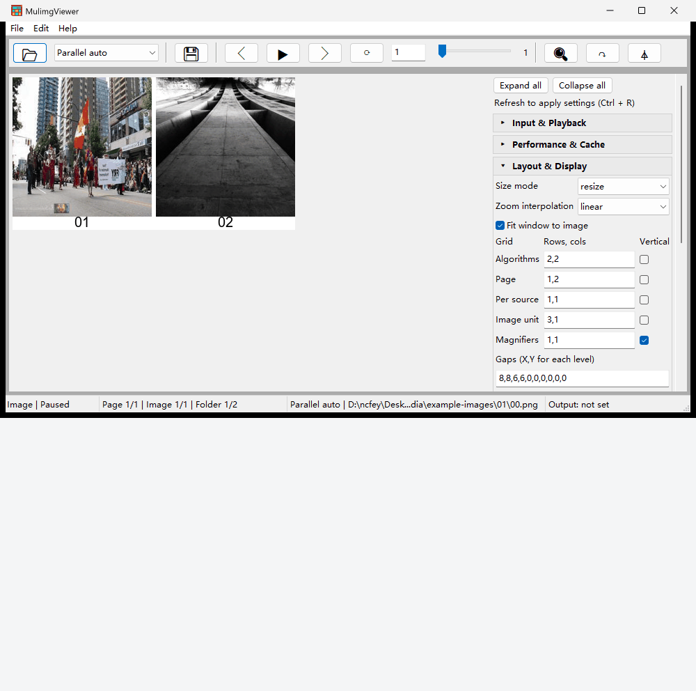

# 图像与视频浏览

## 第一次并排播放两段视频

每个分组的控件位置、输入格式和示例见[右侧设置栏](settings.md)。下图保留主窗口、右侧设置和底部页码，方便逐项对照。

1. 展开右侧 **Input & Playback**，勾选 **Video mode**。在工具栏选择 **Parallel auto**。
2. 在 **Layout & Display** 将 **Page** 设为 `1,2`（一行两列），**Per source** 设为 `1,1`。在 **Input & Playback** 取消 **Multiple frames per source** 和 **Play sources sequentially**。
3. 点击工具栏的文件夹，选择仓库中的 `docs/media/example-videos`。按 **Ctrl+R** 应用布局。左格为猫咪（Cat.mp4），右格为海上日落（Sunset.mp4）。在线阅读时可下载 {download}`Cat.mp4 <../media/example-videos/Cat.mp4>` 和 {download}`Sunset.mp4 <../media/example-videos/Sunset.mp4>`，放入同一空目录后打开。
4. 点 **>** 后点 **▶** 向前播放；点 **<** 后再点 **▶** 则向后播放。按 **Esc** 暂停。页码从 1 开始，可用滑块跳转。修改多个布局或算法参数后，统一刷新即可。

要复现动图的尺寸，在 **Layout & Display** 将 **Display scale** 设为 `1,1`（两个演示片段均为 416 × 416），**Gaps (X,Y for each level)** 填 `8,8,6,6,0,0,0,0,0,0`，勾选 **Image**、**Title** 和 **Fit window to image**，取消 **Magnifier**，在 **Titles** 保留 **Auto title**，再按 **Ctrl+R**。画布中应出现 Cat、Sunset 两个标题；较矮的窗口可滚动右栏查看其余参数。动图逐页展示前五页，帧间停留时间用于阅读。

图像模式也能这样比较。取消 **Video mode**，用 **Parallel auto** 打开 `auto_test_scripts/assets/images`（选择两个来源文件夹的上一级）。演示素材很短，适合练习操作；观察长期播放速度请换用自己的长视频。

## 选对输入和布局

| 工具栏模式 | 图像输入 | 视频输入 | 适用场景 |
| --- | --- | --- | --- |
| Sequential | 单个图像目录 | 单个视频文件 | 浏览一组照片或检查一个视频 |
| Parallel auto | 含多个来源子目录的父目录 | 含多个视频的目录 | 同一位置对照；图像来源宜使用对应文件名 |
| Parallel manual | 逐个选择来源目录 | 逐个选择视频 | 只比较部分来源或调整来源顺序 |
| Image/Video File List | 指定图片清单 | 指定视频清单 | 重现固定输入。可从仓库的 `auto_test_scripts/assets/lists/` 打开 TXT 示例，相对路径以清单所在目录为基准；也支持 CSV |

**Page** 控制每页的行列，`-1,-1` 请求自动布局。**Multiple frames per source** 可在每个来源内连续显示多项，例如 **Per source** 为 `1,3` 时横排三个位置；**Play sources sequentially** 把来源串起来依次浏览。后者也改变挑图范围。

动图中三次设置均使用 **Parallel auto** 和同一个视频目录，每次改完按 **Ctrl+R**：

| 画面 | Input & Playback 勾选项（Video mode 始终开启） | Page | Per source | Display scale |
| --- | --- | --- | --- | --- |
| 两路各一帧 | 两个来源顺序选项均关闭 | `1,2` | `1,1` | `1,1` |
| 两路各三帧 | Multiple frames per source | `1,2` | `1,3` | `0.35,0.35` |
| 按来源逐帧看 | Play sources sequentially | `1,1` | `1,1` | `1,1` |

**Layout & Display** 从外到内依次有算法、页面、单来源、图像单元和放大区五层网格。**Gaps (X,Y for each level)** 中每两个数字分别控制一层的水平、垂直间距，顺序是 Algorithms、Page、Per source、Image unit、Magnifiers。要拉开两种算法的拼接图，改第一对。显示比例 **Display scale** 与保存比例分别设置；处理大图时可先缩小预览。勾选 **Fit window to image** 后刷新，可按画布调整窗口。

## 放大同一区域、比较算法

复现下图：取消 **Video mode**，用 **Parallel auto** 打开仓库的 `docs/media/example-images`。其中两个子目录各有一张 200 × 200 图片。在线阅读时也可下载 {download}`来源 01 <../media/example-images/01/00.png>` 和 {download}`来源 02 <../media/example-images/02/00.png>`，分别存为 `example-images/01/00.png` 与 `example-images/02/00.png`。将 **Page** 设为 `1,2`、**Image unit** 设为 `3,1`、**Display scale** 设为 `1,1`，勾选 **Image**、**Title** 和 **Fit window to image**，保留 **Auto title**，按 **Ctrl+R**。两项的标题分别为来源目录名 01 和 02。

1. 勾选 **Layout & Display → Magnifier**，按 **Ctrl+R**。打开放大工具，在一张图上拖出矩形框。开启图像和放大图显示，即可在其他来源对照同一区域。**Magnifier & Boxes** 可设置框的位置、线宽及框线是否显示。
2. 要微调，勾选 **Magnifier & Boxes → Select individual box**，单击已有框后用方向键移动。第二栏状态信息显示当前框编号和框数；按 Delete 删除选中的框。结束后退出选框模式再画新框。
3. 在 **Custom Functions** 选择 **Image Darkening**，勾 **Selected**，保留 **Show original panel**。把 **Algorithms** 设为 `2,1` 后刷新，原图和处理结果上下对照。选择 **All algorithms** 可同时比较多个算法；网格容量决定能显示多少面板，空位使用间隙颜色。

在 **Titles** 关闭 **Auto title** 后，可组合父目录、文件名、前后缀等字段。颜色在 **Colour & Transparency** 中设置。要改一张图的标题，填写重命名文本，在目标图的右键菜单注入文本，再勾选 **Rename**。

## 找到某一张图

单击图像可在状态栏查看当前项、来源路径和视频时间。打开 **Index table**，用 **Visual items** 按画面上的位置查找，**Pages** 查页，**Sources** 查原始来源。可由主窗口选中项定位到表格，也可双击表格行跳回对应页。路径详情支持复制；尚未拆出的帧可先有预期路径，等缓存就绪后文件才存在。需要离线核对时，可导出当前视图的 Excel 表格。

## 播放卡顿时看什么

把鼠标放在 **Performance & Cache → Power mode** 上，对比实际播放 FPS 与供给 FPS（后台产出可显示页面的速度）。每秒显示一页可以同时更新多路视频，不能把页率乘以来源数当作单路帧率。

| 现象 | 可先调整 |
| --- | --- |
| 播放均匀，但比预期慢 | 查看 **Interval (s)**。手动设定是切换间隔的下限，例如 1 秒最多约每秒翻一页；需要更快时先减小它 |
| 跳转后首屏慢，随后恢复 | 跳到长视频深处需要寻帧并准备当前页；先用较小预览比例，比较各来源的分辨率和编码 |
| 供给持续跟不上 | 从 Balanced 切到 Performance 或 Maximum；如果仍受限，减小预览尺寸、可见算法数或每页图像数 |
| 大体流畅，偶尔等下一页 | **Cache frames** 控制近区，乘以 **Cache multiplier** 得到外层范围。适当增大可利用空闲资源提前准备，代价是更多磁盘读写和空间 |

Eco、Balanced、Performance、Maximum 提供不同的 CPU 和内存预算。持续速度还取决于解码、算法、拼接和磁盘。缓存会随浏览位置更新；需要长期保留的结果请导出。

## 挑图和导出

在 **Save Settings** 选择输出目录、输出模式、格式和比例。点击工具栏保存图标或 **Ctrl+S** 后，后台按点击时的设置生成文件，右侧状态栏显示进度。

| 输出选项 | 得到什么 |
| --- | --- |
| Stitch | 最终画面在 `composed`，各算法的拼接图在 `algorithms/<算法>/stitch_images` |
| Selected images | 选择结果在各算法的 `select_images` 中，按来源归档 |
| Magnifiers | 输出放大区域和带框图。组合模式下，没有框会跳过这一项，其他已选输出照常保存 |

**挑选规则。** 单击确定位置，再保存 **Selected images**；右键 **Select image** 是该操作的快捷方式。Parallel auto/manual 会从各来源选同一位置，在 Multiple frames per source 下会保留点中的来源内偏移。Sequential、File List 和 Play sources sequentially 只挑当前项；显示算法时也可输出相应处理结果。图像模式的移动选项会移动源文件，首次尝试建议使用副本；视频模式不会移动源视频。

**画质。** JPG 可调质量，采用 4:4:4 色度采样；PNG 的压缩级别影响耗时和文件大小；PDF 可选 Lossless 或 Compact (JPG)。保留视频解码所得细节时，选择 PNG 缓存、输出比例 `1,1`，导出 PNG 或 Lossless PDF。这样可以避免额外的 JPG 编码；视频源本身的压缩损失仍存在。缓存选 **auto** 时，PNG/PDF 且两个输出比例均至少为 1 会用 PNG，否则用 JPG。修改缓存格式后手动刷新。

**批量保存。** 勾选 **Save all pages**后点击保存，**Esc** 暂停，重新点击保存继续。如果改变了保存参数，再次保存会从头开始。在 **Configuration** 中 **Save / Load** 可保存、取回一套配置；**Reset** 恢复默认设置。正常关闭窗口会记住最后使用的参数。
